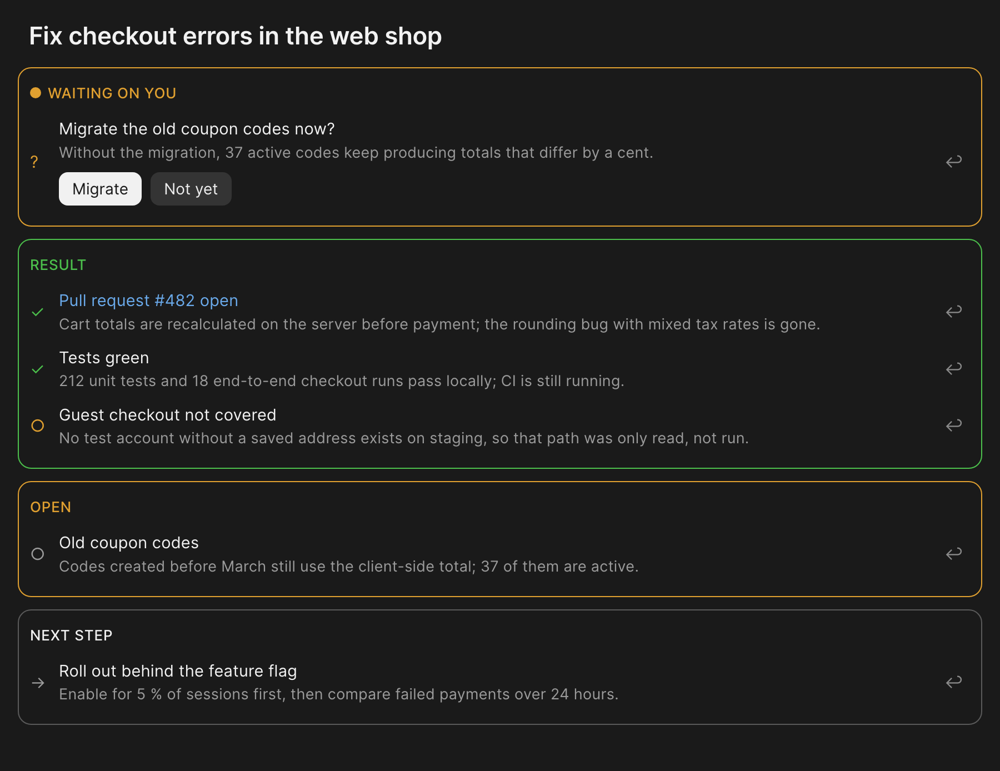
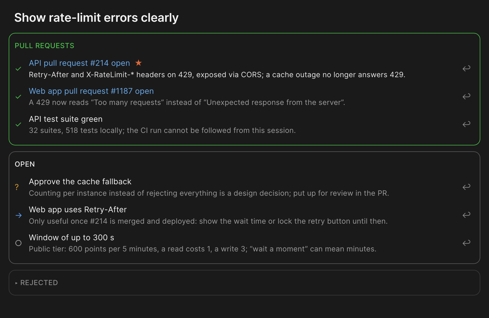
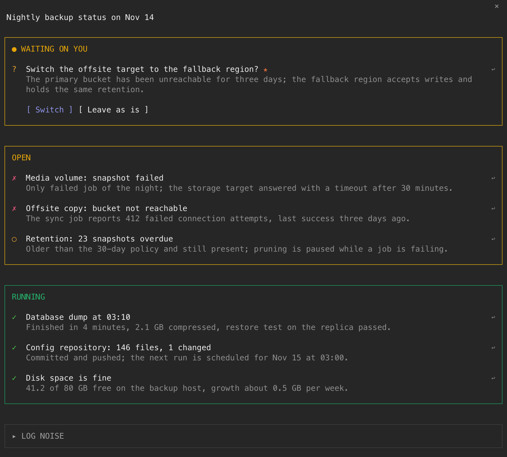

# session-glance

A Claude Code mod (plugin) that keeps a **glance pane** beside the chat: the
current state of the session topic, not the path taken.

- **Topic** as headline, then 2–6 sections (results, decisions, open points,
  next step, running jobs), at most 5 items each.
- **Waiting on you:** items marked `waiting` collect in a box at the top.
  With `choices` (1–4 short answers, recommended first) they get buttons; a
  click sends `<text> → <choice>` as your next prompt and the item shows
  `↳ <choice>` until Claude updates the pane.
- Items can carry an icon, a tone, a link (only URLs seen in the session) and a
  ★ for notable findings. Side sections start collapsed and can be toggled.
- **↩ on each item** puts it as a quote (`> Section · text — sub`) into the chat
  draft at the cursor, for a follow-up question. Nothing is sent.
- The pane title shows the time of the last update and the estimated tokens
  spent on the tool so far.

## What it looks like

In the desktop app, with a question waiting on you and its answer buttons:



Linked items, a ★ for a notable finding and a collapsed side section:



The same pane in the terminal:



The screenshots show made-up example sessions.

## Feedback

Bugs and ideas are welcome as
[issues](https://github.com/mfal/session-glance/issues). Pull requests are not
accepted, see [CONTRIBUTING.md](CONTRIBUTING.md). Security problems go through
[private reporting](SECURITY.md).

## How it works

The mod registers the tool `mcp__session-glance__update`. Its description tells
Claude what belongs in the pane and to call it once at the end of each turn
that changed the state. Every call replaces the whole pane.

| Trigger | Effect |
| --- | --- |
| `/glance` | opens the pane |
| typing just `glance` | opens the pane and asks Claude to fill it with the full current state |
| session start | reopens the pane if the session already has content |
| `wrap_up` in a turn without a glance update | refused once with a nudge to update the pane first; the second `wrap_up` of the turn always passes |

State lives in `$.state` (per session): the glance, the user's collapse
toggles and the usage counter.

## Install

The repository is its own marketplace (`.claude-plugin/marketplace.json`).
From GitHub:

```bash
claude plugin marketplace add mfal/session-glance
```

```bash
claude plugin install session-glance@session-glance
```

To get a newer version later:

```bash
claude plugin marketplace update session-glance
```

```bash
claude plugin update session-glance@session-glance
```

From a local clone, pass the folder instead of `mfal/session-glance`, for
example `claude plugin marketplace add ~/dev/skills/session-glance`.

While developing, load it straight from the folder instead:

```bash
claude --plugin-dir ~/dev/skills/session-glance
```

## Publish to the organization library

Colleagues get session-glance from the claude.ai organization library, not
from this repo: a new version reaches them only once it is published there.
Bump `version` in `.claude-plugin/plugin.json` first.

Publishing from Claude Code (`PublishPlugin`) refuses this folder with "That
folder holds no plugin" as long as `.claude-plugin/marketplace.json` sits next
to `plugin.json`. Move it out for the upload and put it back right after:

```bash
mv ~/dev/skills/session-glance/.claude-plugin/marketplace.json /tmp/session-glance-marketplace.json
```

Publish (an existing upload of the same name needs `replace: true`), then:

```bash
mv /tmp/session-glance-marketplace.json ~/dev/skills/session-glance/.claude-plugin/marketplace.json
```

## Check

```bash
claude plugin validate ~/dev/skills/session-glance
```

Once the engine has loaded the mod, `.claude-plugin/types/` holds the API
types (git-ignored) and `tsc -p ~/dev/skills/session-glance` type-checks it.

## Files

- `.claude-plugin/plugin.json`: manifest
- `.claude-plugin/marketplace.json`: makes the folder installable
- `hooks/register.tsx`: entry point, wires the hooks (tool, command, prompt
  trigger, `wrap_up` gate)
- `hooks/prompts.ts`: every text Claude reads: tool description, field
  descriptions, the two mid-session messages
- `hooks/glance.ts`: names, parsing of the tool input, derived values
- `hooks/pane.tsx`: pane rendering and its buttons
- `types/index.d.ts`: state contract

## License

[MIT](LICENSE)
